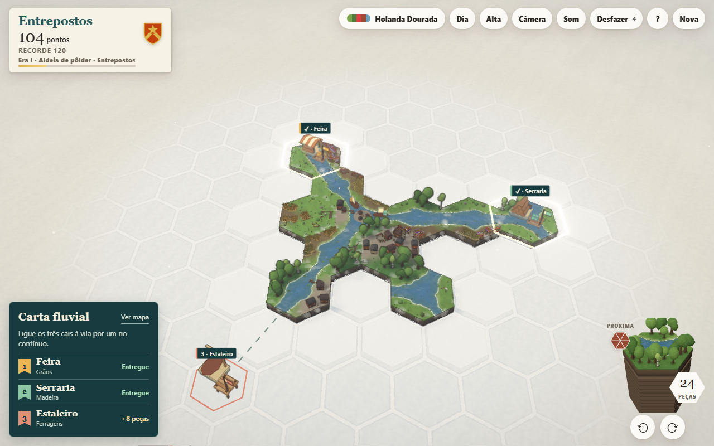

# Validação da edição Entrepostos

A edição parte do commit `d22626c` do Dorf. O build de distribuição é um HTML único. As capturas abaixo foram feitas abrindo o arquivo compilado no Chrome do Windows.

## Regras e interface

| Verificação executada | Resultado |
|---|---|
| TypeScript, simulação e build | `npm run check` passou. Foram 52.694 jogadas em 600 partidas. Os 600 replays completos e 6.600 parciais tiveram zero divergências. |
| Navegação dirigida | 36 sementes concluídas. Em todas, foi possível abastecer a Feira na segunda peça. O roteiro reserva espaço para os três canais. A taxa se refere a essa estratégia programada. |
| Entrega tardia | Um cais em trecho isolado esperou a ligação com o rio central. Prolongar o canal depois da entrega manteve o crédito único. |
| Partida no navegador | Na semente 42, o roteiro de mouse e teclado chegou aos três cais em 14 jogadas e 715 pontos. O save restaurou o cais abastecido. Desfazer retirou a entrega e permitiu refazê-la. A chave de save do original conservou seu valor. |
| Gráficos | O teste de fumaça reconheceu WebGPU e WebGL2 na GPU do sistema. A viagem no desktop rodou em Alta com WebGPU. O teste de toque usou WebGL2 e qualidade Média. |
| Apresentação | Inspeção visual da abertura, da viagem, dos cais à noite, do Vale e de uma interação na Toscana. Na viewport de 390 × 844, a carta, a rotação e a confirmação por toque funcionaram. O teste móvel foi emulado no desktop. |
| Bateria | Com timestamps simulados de 60, 90, 120 e 144 Hz, o agendador respeitou as metas de 20 e 30 quadros por segundo. Autonomia física de bateria exigiria medição em aparelho. |

## Comparação na GeForce RTX 3060

Chrome headless no Windows, backend WebGPU nativo, viewport de 1280 × 800, qualidade Alta, tema Vale, modo Clássico e semente 42. O teste acrescentou 300 peças à inicial, chegando a **301 peças e 50.536 instâncias estáticas nas duas edições**. Cada câmera passou por quatro execuções na ordem original, Entrepostos, Entrepostos, original. Foram 90 quadros de aquecimento e 180 medidos por execução.

| Câmera | Edição | Chamadas de desenho nas duas execuções | Intervalo mediano entre quadros (ms) | Percentil 95 do intervalo (ms) |
|---|---|---|---|---|
| Próxima, zoom 8 | Original | 157 / 157 | 33,3 / 49,3 | 49,9 / 50,6 |
| Próxima, zoom 8 | Entrepostos | 149 / 150 | 33,3 / 33,2 | 34,0 / 33,8 |
| Aberta, zoom 28 | Original | 147 / 147 | 32,9 / 35,3 | 33,6 / 36,6 |
| Aberta, zoom 28 | Entrepostos | 137 / 137 | 33,1 / 18,0 | 33,7 / 35,7 |

O percentil 95 indica o intervalo que abrangeu 95% dos quadros de cada execução. Na câmera próxima, as duas amostras da edição tiveram menos quadros longos. Na aberta, a edição economizou dez chamadas e os intervalos se sobrepuseram. O relógio observado foi o de `requestAnimationFrame`, que inclui a apresentação e o agendamento do navegador. As duas execuções por condição e a única placa delimitam a generalização. [Resultados por execução](desempenho.jsonl)

Para a próxima rodada de otimização, testaria dividir apenas os kits estáticos mais pesados por região. Hoje o chão já está em blocos, mas as decorações do mesmo kit ocupam um pool global. O teste decisivo é aproximar e afastar a câmera na mesma semente. O recorte regional precisa reduzir o tempo dos quadros lentos de perto sem encarecer a vista aberta pelo excesso de chamadas.

[Captura noturna](screens/noite.png) · [Captura da interface móvel](screens/celular.png)

