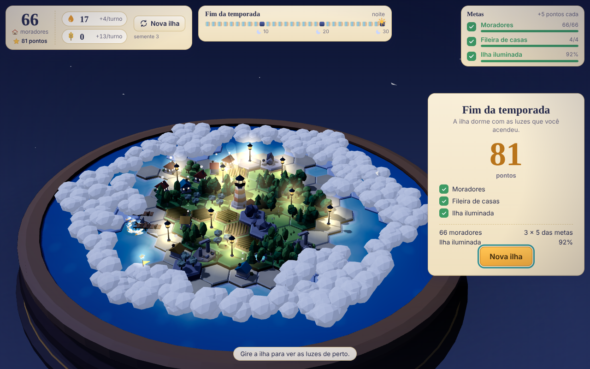
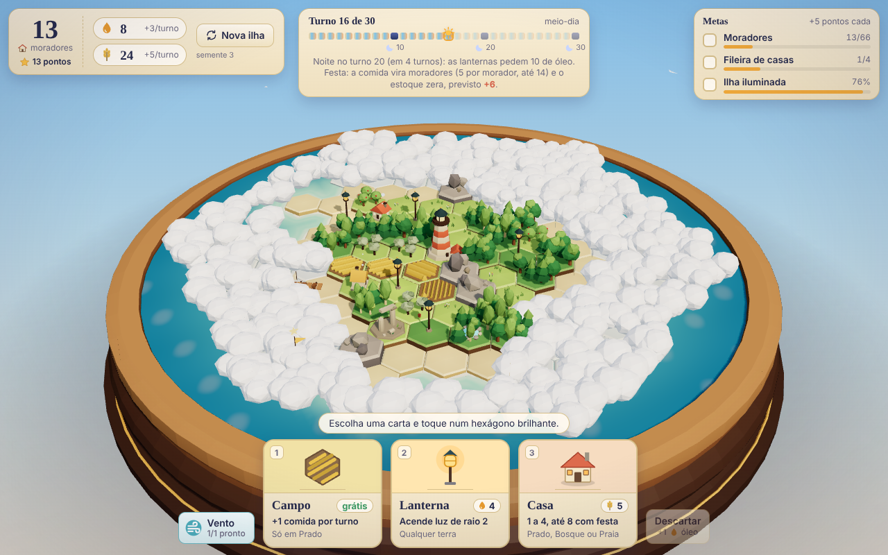
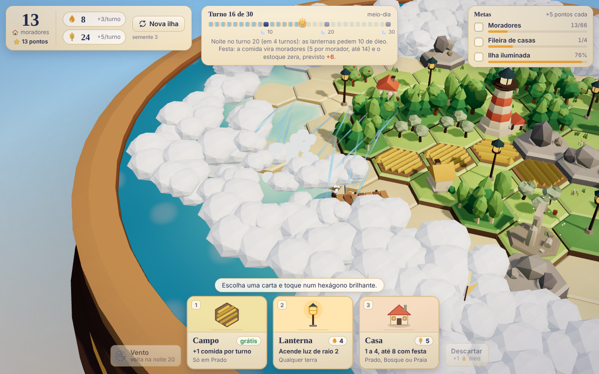
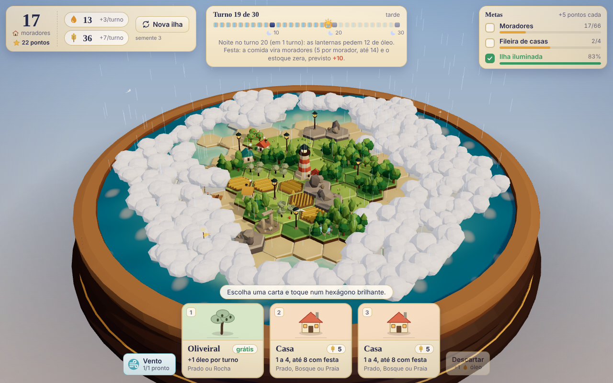

# Ilha das Lanternas: relatório da versão inicial

## O que foi construído

Um jogo de cartas e exploração numa ilha hexagonal coberta de névoa, em 3D, que roda no navegador. Resumo das regras:

- **A ilha:** um mapa de hexágonos (raio 7, cerca de 95 de terra) cercado de água. No centro fica o Farol velho, já aceso. Tudo o que está longe da luz fica escondido sob nuvens baixas.
- **A partida:** 30 turnos, de 10 a 15 minutos. A cada turno o jogador vê 3 cartas, escolhe 1 e a coloca num hexágono brilhante. As outras 2 voltam ao fundo do baralho (58 cartas). Se preferir, descarta uma carta e ganha +1 de óleo, então nunca fica sem jogada.
- **As cinco cartas:**
  - Casa (custa 5 de comida): abriga de 1 a 4 moradores, e quanto mais variados os vizinhos (campo, bosque, água, lanterna, pomar), mais moradores.
  - Campo: rende +1 de comida por turno.
  - Oliveiral: rende +1 de óleo por turno.
  - Lanterna (custa 4 de óleo): acende e revela a névoa num raio de 2 hexágonos.
  - Cais: rende +1 de comida por turno, na praia.
- **Dois recursos:** comida (para construir casas) e óleo (para lanternas).
- **A luz:** as lanternas revelam o mapa (a revelação é permanente) e protegem as casas na noite.
- **Noites nos turnos 10, 20 e 30:** cada lanterna queima 2 de óleo (a que fica sem óleo apaga). A casa sem lanterna encostada perde 1 morador. **Festa:** a comida guardada vira moradores (5 de comida = +1 morador, até 14 por noite, em casas iluminadas com vaga; cada casa recebe até 4 convidados além dos 4 da variedade) e o estoque zera.
- **Sopro do vento:** quem joga tem 1 sopro. Tocar numa nuvem de névoa encostada na luz dissolve a névoa num raio 1: mostra o terreno e os achados, mas não ilumina (só a Lanterna cabe ali; não conta nas metas). Não gasta o turno e recarrega a cada noite, com no máximo 1 guardado. Tocar no céu vazio faz chover por 4 s, só pelo prazer.
- **Achados escondidos:** 6 por ilha (2 ruínas, 1 cardume, 2 pomares, 1 nascente), que só aparecem quando a luz chega neles e dão bônus.
- **Três metas por partida**, sorteadas entre cinco (ponta marcada, 66 moradores, 5 achados, fileira de 4 casas, 80% da ilha iluminada). Cada meta cumprida vale +5 pontos. A pontuação final é moradores mais metas.
- **O visual:** um diorama, como uma maquete sobre um pedestal de madeira, com mar recortado, casinhas, campos, árvores, cais e farol. A hora do dia avança do amanhecer ao entardecer, e nas noites as lanternas e janelas acendem. Tudo é desenhado por código, sem arquivos de arte.

## Como abrir e jogar

- **Mais simples:** o arquivo `jogos/lanternas/dist/index.html` já vem pronto no repositório. Basta baixá-lo e abrir com dois cliques, direto no navegador, sem instalar nada. É um arquivo único e funciona offline. Conferi abrindo por `file://` num Chromium: o jogo carrega, mostra as 3 cartas e não dá nenhum erro no console.
- **Para mexer no código:** `cd jogos/lanternas && npm install && npm run dev`. Para refazer o arquivo único depois de mudar o código: `npm run build`, que sobrescreve `dist/index.html`.
- **Controles:**
  - clicar numa carta para escolhê-la (ou as teclas 1, 2 e 3);
  - clicar num hexágono brilhante para colocar a carta (no celular, o primeiro toque mostra a peça e o segundo confirma);
  - arrastar gira e inclina a ilha (também as setas do teclado);
  - a roda do mouse aproxima e afasta (ou pinça no celular, teclas + e -);
  - "Descartar" (ou a tecla D) joga fora a carta escolhida e dá +1 de óleo; Esc desfaz a escolha;
  - "Vento" (ou a tecla V) arma o sopro e marca as nuvens que ele alcança; também dá para tocar direto numa nuvem (no celular, toque duas vezes). Tocar no céu faz chover;
  - `?seed=N` no endereço repete a mesma ilha (por exemplo `index.html?seed=3`).

## O que os testes mostraram

Foram simuladas 300 partidas completas para cada jogador automático: o aleatório, o guloso (olha só o ganho imediato), o planejador (pensa em luz, metas e noites) e o planejador com sopro do vento. Nenhum deles enxerga o baralho, os achados nem o terreno sob a névoa.

| Jogador | Média | p10 | p50 | p90 | Ilha revelada | Escolha apertada |
|---|---|---|---|---|---|---|
| Aleatório | 35,5 | 25 | 36 | 47 | 58% | 0% |
| Guloso | 59,2 | 49 | 60 | 70 | 50% | 38% |
| Planejador | 73,8 | 64 | 74 | 83 | 82% | 37% |
| Planejador com sopro | 77,2 | 68 | 78 | 86 | 83% | 38% |

(p10, p50 e p90: a pontuação abaixo da qual ficam 10%, 50% e 90% das partidas. "Escolha apertada": nos turnos em que a melhor e a segunda melhor carta valem quase o mesmo, a fração de turnos em que o jogador tem uma decisão difícil de verdade. As médias subiram em relação à primeira versão porque a festa da noite ficou maior; a meta de moradores subiu de 52 para 66 por isso.)

- **Jogar bem compensa:** o planejador faz 2,08 vezes a pontuação do aleatório e 1,25 vez a do guloso.
- **A festa agora é medida de verdade.** Antes, "comida final < 15" passava por construção (a festa zera o estoque). Agora o simulador mede a comida que cada jogador perde por noite (a que passa do teto de moradores ou não acha casa com vaga). O planejador perdia **35,6 por noite** com a festa antiga; com a festa de 5 por 1, até 14 moradores e 4 convidados por casa, perde **2,5** (critério: até 4). A comida ainda sobra em volume (~40 a 57 antes das noites 2 e 3), mas agora é escoada; ver `docs/simulacao.md`.
- **O sopro do vento vale +3,4 pontos** ao planejador (±0,8; critério: entre +1 e +6). Ele usa os 3 sopros possíveis por partida (início e depois das noites 10 e 20) e melhora a meta de achados de 71% para 83%. Para o sopro valer algo foi preciso deixar a Lanterna ser posta na terra soprada; sem isso o ganho era de +0,3.
- **Metas (entre as partidas em que foram sorteadas), planejador sem sopro:** ponta marcada 41%, moradores 58%, achados 71%, fileira 33%, ilha iluminada 71%. Nenhuma é automática e nenhuma é impossível.
- **Uso das cartas, planejador:** Casa 34%, Lanterna 27%, Campo 19%, Cais 10%, Oliveiral 11%. Nenhuma carta passa de 45%, então a escolha não é óbvia.
- **Partidas travadas:** 0% em todos.
- **Invariantes (verificações de sanidade):** a mesma semente dá sempre a mesma partida (também com sopros), casa nunca passa de 8 moradores (4 da variedade e 4 da festa), recursos nunca ficam negativos, o sopro não gasta o turno nem ilumina e o replay (semente + ações) refaz a partida. Todas passaram.
- **Desempenho (render por software, sem placa de vídeo):** de 37 a 65 draw calls e de 147 a 178 mil triângulos nas 13 capturas (maior: o fim da partida), dentro do limite que fixamos (150 e 300 mil). O FPS numa placa de vídeo de verdade ainda não foi medido.
- **Console:** sem erros nas capturas nem no teste de interação (mouse, teclado e toque). O comando de verificação (`npm run check`: tipos, simulação e build) passa.
- **Comida e óleo no fim:** o óleo final do planejador é 6,6 em média.

## Avaliação dos 5 jogos

| Jogo | Potencial para o Roger | Custo | Riscos | Ideia que diferencia |
|---|---|---|---|---|
| Ilha das Lanternas | Alto: construir + explorar + metas curtas numa mesma tela | Baixo (reaproveita a experiência hexagonal do Retalhos) | Parecer "mais um Dorfromantik"; a economia virar conta | A luz como recurso: acender revela o mapa e protege as casas na noite |
| Cidade das Quatro Estações | Alto no visual (Weatherglass) | Médio | A economia sazonal ficar complexa; ritmo lento | O ano como relógio da partida: cada estação muda o que rende |
| Diário de Bordo | Médio-alto (exploração pura) | Médio | Pouca construção, que é o que o Roger mais gosta; comida limitada pode frustrar | O diário ilustrado que se preenche com os achados |
| Mascates do Vale | Médio | Médio-alto (caminho e carroças animadas) | Virar quebra-cabeça de rotas frio | Desenhar trilhas e ver a vida passar por elas |
| Província | Médio sozinho, alto como camada | Alto | Sem desafio próprio; muitas telas | O mapa de regiões como coleção das ilhas já jogadas |

**Melhor para começar: Ilha das Lanternas** (mantive a ordem anterior). Motivos: é a única que junta as três coisas que o Roger mais gosta (construir, explorar, meta simples) com o menor custo; a regra cabe em 5 cartas e 2 recursos; e a recompensa visual (a ilha acesa à noite) é forte e barata.

## Ordem dos esboços e critérios

**Ordem:** Ilha (feito) > Quatro Estações enxuta (2 recursos, sem trabalhadores) > Diário de Bordo > Mascates > Província como camada da Ilha (cada ilha jogada vira uma região).

**Critérios comuns a todos os jogos.**
- Continuar se: o Roger joga 2 partidas seguidas por vontade própria; o simulador mostra planejador > guloso em pelo menos 1,2 vez e escolha apertada entre 25% e 65%; e uma captura sozinha já dá vontade de jogar.
- Parar se: depois de 2 rodadas de ajuste as escolhas continuam óbvias (uma carta acima de 45%) ou a partida passa de 15 minutos; ou se o Roger acha a conta mais interessante que a paisagem.

**Critérios específicos.**
- Estações: parar se precisar de um 3º recurso.
- Diário: parar se a fome decidir mais que a curiosidade.
- Mascates: parar se traçar trilhas não for gostoso no toque.
- Província: só começar quando a Ilha tiver 10 partidas jogadas.

**Os 3 primeiros pedidos de maior valor de cada jogo** (para a Ilha, são os próximos passos):

- **Ilha:**
  1. O Roger joga 3 partidas e anota onde ficou sem saber o que fazer. Pronto quando houver 3 anotações.
  2. Comida escassa de verdade: a festa já escoa a sobra, mas a renda é umas 3 vezes o que casas e festa gastam. Cortar a renda (menos Campo e Cais no baralho, ou campo que rende só por alguns turnos) e medir se Campo contra Oliveiral vira uma escolha difícil. Pronto quando o planejador guardar menos de 20 de comida antes da noite 3 sem a meta de moradores cair abaixo de 20%.
  3. Ensinar as regras novas em 3 dicas curtas nas primeiras jogadas (festa da noite, sopro do vento, lanterna na terra soprada). Pronto quando um jogador novo usar o sopro na 1ª partida sem ler a ajuda.
- **Estações:** (1) regra com formas simples e simulador (4 estações × 6 turnos, 2 recursos); (2) um canto do mapa bonito em cada estação; (3) o Roger joga.
- **Diário:** (1) regra de navegação e comida com simulador; (2) a página do diário desenhada; (3) o Roger joga.
- **Mascates:** (1) traçar trilha no toque com formas simples; (2) carroças andando; (3) o Roger joga.
- **Província:** (1) salvar cada ilha jogada; (2) o mapa de regiões com as ilhas; (3) uma meta que atravessa ilhas.

## Decisões tomadas

- **WebGL, não WebGPU**, por robustez: funciona em mais aparelhos e navegadores.
- **Projeto independente** em `jogos/lanternas`, sem mexer no Retalhos.
- **Regras em código puro**, sem tela, testável com semente: a mesma semente dá a mesma partida, por isso o simulador é confiável.
- **Números ajustados pelo simulador** (os motivos estão em `docs/simulacao.md`):
  - Casa passou de 1 para 5 de comida e Lanterna de 2 para 4 de óleo, porque os recursos sobravam e Campo e Oliveiral não valiam nada;
  - baralho de 58 cartas, para que as cartas que sobram sejam uma escolha de verdade;
  - a noite queima 2 de óleo por lanterna, o que liga a economia à noite;
  - festa da noite: a comida guardada vira moradores (5 por 1, até 14 por noite, 4 convidados por casa) e o estoque zera, e o simulador mede a comida que se perde (testadas também casa mais cara, fome e menos campos; ver `docs/simulacao.md`);
  - sopro do vento: revela sem iluminar, não gasta o turno, recarrega na noite; a Lanterna cabe na terra soprada (sem isso valia +0,3 ponto e era enfeite);
  - socorro da lanterna: se a luz não tem mais terra vazia, a lanterna pode ir à névoa encostada, o que resolveu a única partida travada;
  - mão garantida: se nenhuma das 3 cartas cabe, a 3ª é trocada por uma que caiba;
  - jogadores automáticos sem espiar a névoa: a primeira versão trapaceava, e as metas foram recalibradas depois disso (66 moradores depois da festa maior, 5 achados, fileira de 4, 80% da ilha).
- **Arte toda em código**, sem arquivos de imagem ou modelo.
- **Fontes do sistema**, sem baixar nada da internet.
- **HTML único**, que abre offline.

## Próximos 3 passos

1. O Roger joga 3 partidas e anota onde ficou sem saber o que fazer (pronto com 3 anotações).
2. Comida escassa de verdade: cortar a renda de comida e medir se a escolha entre Campo e Oliveiral aperta (pronto quando o planejador guardar menos de 20 de comida antes da noite 3 sem a meta de moradores cair abaixo de 20%).
3. Três dicas curtas nas primeiras jogadas para a festa e o vento (pronto quando um jogador novo usar o sopro na 1ª partida sem ler a ajuda).

## Quem fez o quê

- **Opus 5.5:** avaliou, planejou e auditou (rodou o check e olhou as capturas, apontou o botão Descartar na tela final e a sobra de comida).
- **Haiku:** leu e resumiu as skills threejs-* e frontend-design.
- **Sonnet 5.5:** construiu as regras, o simulador, o protótipo, a passada visual, as capturas e este relatório.
